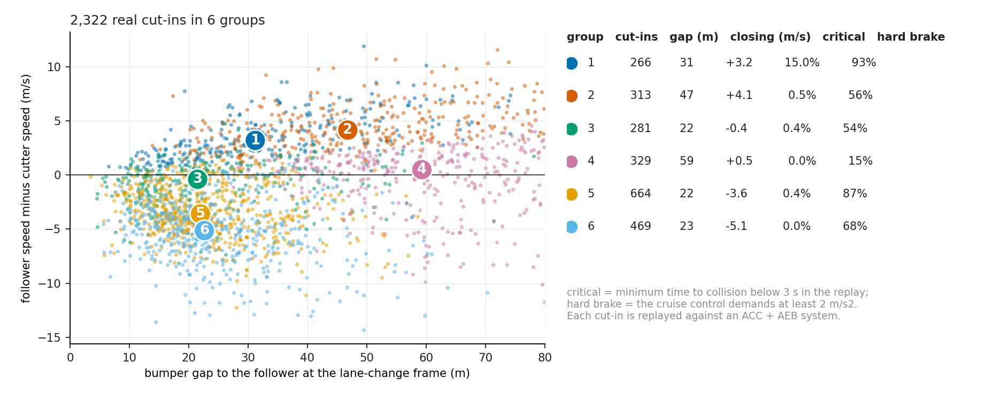
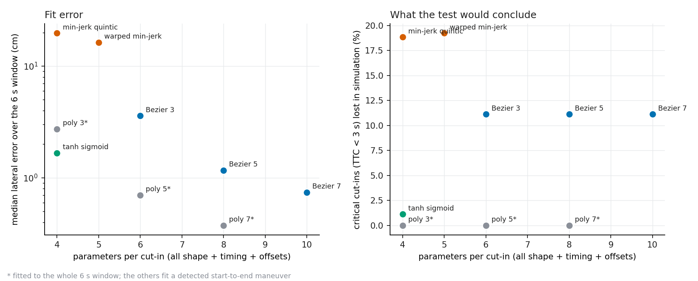
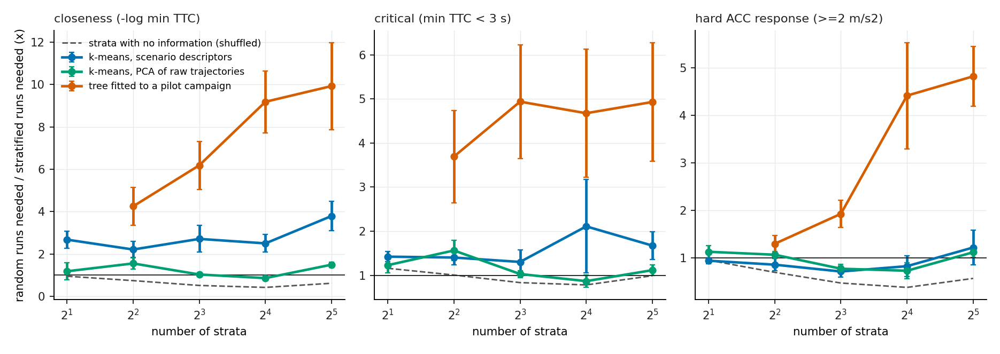

# cutin-atlas

**Which trajectory description keeps a cut-in test honest, and how few simulations does it take to estimate how a system copes with cut-ins?** I extracted 2,322 real cut-ins from the highD drone dataset, described each one with nine competing trajectory parameterizations, replayed every cut-in (real and reconstructed) against an adaptive cruise control with automatic emergency braking, clustered the cut-ins four ways, and measured how many simulation runs strata built from the clusters save.



## At a glance

| question | answer |
|---|---|
| Which trajectory description keeps a cut-in test honest? | A **4-parameter tanh sigmoid**: reproduces all 11 cut-ins that end in contact and loses 1.1% of critical ones. The common fixed-shape minimum-jerk curve loses 18.8%. |
| Where does the danger sit? | One group in nine (follower 3 m/s faster, 31 m gap): **15%** critical against at most 0.5% in every other group. |
| How many simulations can strata save? | **4.7x** fewer runs for critical events and **9.2x** for closeness to collision, with 16 strata fitted on a pilot campaign (100 runs). Strata without information: 1x or worse. |

## What I did

- **Real cut-ins.** From all 60 [highD](https://www.highd-dataset.com/) recordings (free for non-commercial research after registration; not redistributed here; six locations): a vehicle changes lane and lands in front of a following car in the target lane, with both tracked for the 3 s before and after the lane-change frame, a bumper gap of at most 80 m and a passenger-car follower. That gives **2,322 cut-ins** (2,176 by cars, 146 by trucks). Signals: lateral offset in lane widths, bumper gap, both speeds, at 25 Hz.
- **Closed-loop replay.** The cutter follows its recorded trajectory. The follower is replaced by a constant time-gap cruise control plus an emergency brake that reacts to its own delayed, noisy time-to-collision measurement, starting at the follower's recorded speed and only seeing the cutter once it is in its path. 8 system settings (brake trigger, sensor delay, brake strength) times 5 noise draws per cut-in.
- **Trajectory parameterizations (C1).** Nine families fitted to each cut-in's lateral path: minimum-jerk quintic, a time-warped version, Bezier curves of degree 3, 5 and 7 on a detected start-to-end maneuver, a tanh sigmoid, and polynomials of degree 3, 5 and 7 on the whole 6 s window. Each reconstruction is replayed the same way as the real trajectory, with identical noise.
- **Clustering (C6).** Four representations (eight scenario descriptors, curve parameters, PCA of raw trajectories, an autoencoder) times four algorithms (k-means, Gaussian mixture, Ward hierarchical, HDBSCAN), fitted on half of the recordings and evaluated on the other half.
- **Sampling efficiency.** A simulation campaign wants the average outcome over all cut-ins from as few runs as possible. I compared plain random sampling with stratified sampling, where the strata come from clusters or from a regression tree fitted on a pilot campaign's outcomes, with a pilot-then-allocate plan and a control with shuffled strata.

## Results

### 1. A 4-parameter sigmoid keeps the test's conclusions; the usual fixed-shape curve does not



| parameterization | parameters | median error (cm) | critical cut-ins lost | cut-ins with contact reproduced (of 11) |
|---|---|---|---|---|
| min-jerk quintic | 4 | 19.7 | 18.8% | 10 |
| warped min-jerk | 5 | 16.3 | 19.2% | 8 |
| Bezier degree 3 / 5 / 7 | 6 / 8 / 10 | 3.6 / 1.2 / 0.7 | 11.1% | 10 |
| **tanh sigmoid** | **4** | 1.7 | **1.1%** | **11** |
| polynomial degree 3 (whole window) | 4 | 2.7 | 0% | 11 |
| polynomial degree 5 (whole window) | 6 | 0.7 | 0% | 11 |
| polynomial degree 7 (whole window) | 8 | 0.4 | 0% | 11 |

"Critical" is a minimum time to collision below 3 s in the replay; 11 of the 2,322 real cut-ins end in contact in at least one setting. The fixed-shape min-jerk curve, the usual choice for generated lane changes, loses about one critical cut-in in five. Bezier curves fitted on a detected maneuver lose about one in nine, because 42% of maneuvers cannot be cut out cleanly (they run past the edges of the 6 s window or are too short; the 95th-percentile error is 19.5 cm); curves fitted to the whole window avoid that. Agreement on whether the cruise control brakes hard (at least 2 m/s²) is 97.2% for min-jerk, 99.9% for the sigmoid and 100% for the degree-7 polynomial.

### 2. The cut-in atlas: one group in nine holds nearly all the danger

Six k-means groups on the eight descriptors (picture at the top). Group 1 is 266 cut-ins (11%) where the follower is about 3 m/s faster than the cutter at a gap of about 31 m: 15% of them are critical in the replay and 93% make the cruise control brake hard, against at most 0.5% critical in every other group.

### 3. Clusters chosen the usual way barely help; strata that know the outcome help a lot

Clusters picked by silhouette are small in number (k = 2 or 3 for almost every method), and their stability on bootstrap resamples (adjusted Rand index) is 0.74 to 0.97 for the descriptors with k-means, Gaussian mixture or Ward and 0.21 to 0.93 for the trajectory-based ones. For the critical-event outcome, strata from these clusters give 1.4x to 1.5x fewer simulations at the same accuracy with the descriptors and 1.0x to 1.2x with curve parameters, PCA or the autoencoder. Between-cluster share of the outcome variance: 3.1% to 3.4% for the descriptors, 0.6% or less for PCA and the autoencoder.

Then I varied the number of strata and let a regression tree on the descriptors, fitted to the outcomes of a pilot half of the recordings, define them (evaluated on the other half, 100 runs, 8 random splits):



| strata (16 of them) | closeness (-log min TTC) | critical (TTC < 3 s) | hard ACC response |
|---|---|---|---|
| tree fitted to the pilot | **9.2x** | **4.7x** | **4.4x** |
| k-means on descriptors | 2.5x | 2.1x | 0.8x |
| k-means on PCA of raw trajectories | 0.9x | 0.9x | 0.7x |
| shuffled strata (control) | 0.3x | 0.8x | 0.3x |

Read 4.7x as: 100 runs on tree strata reach the accuracy that about 470 random runs would. Shuffled strata, which carry no information, give 1.2x or less everywhere, so the gains are not an artefact of the allocation rule. The uncertainty is large for the critical outcome (standard deviation 1.5x across splits at 16 strata).

## How it was built

```
highD CSV -> extract (cut-ins, signals.npz) -> replay (ACC + AEB, vectorised)
          -> param (9 families) -> study_param
          -> features (descriptors, curve params, PCA, autoencoder) -> study_cluster, study_strata -> figures
```

- Every parameter is in `configs/default.toml`.
- 8 automated tests: replay physics (a cutter in another lane never collides, a close cut-in ahead of a faster follower always does, determinism for a seed), curve fits recovering a known sigmoid, the highD lane numbering, and the variance formulas for stratified sampling.
- The two sampling studies ran on Kaggle's free CPUs (`kaggle/`); the rest runs in minutes on a laptop.
- A first version of the efficiency measure compared a plain random sample's variance with an adaptive allocation's variance and showed gains for shuffled strata, because adaptive allocation can be slightly biased. I switched to mean squared error against the true population mean, which is what the numbers above use.

```bash
pip install -e .[dev]
# put the highD CSVs (01_tracks.csv, 01_tracksMeta.csv, 01_recordingMeta.csv, ...) in data/highd/
python -m cutin.extract && python -m cutin.study_param
python -m cutin.study_cluster && python -m cutin.study_strata && python -m cutin.figures
pytest
```

## Limits

- The follower in the replay is a simulated cruise control that keeps its starting speed, not the human who actually drove, who often began to slow before the cutter arrived. Contact therefore appears in 11 cut-ins, and the results say how a defined system copes with real cut-in kinematics, not how often real cut-ins end in crashes.
- 1,891 of the 2,322 cut-ins come from one location; the other five contribute 37 to 151 each.
- Maneuver-based curve fits use only the 58% of cut-ins whose lateral movement fits inside the 6 s window to define start and end; the others are fitted with the detected, truncated segment.
- Strata efficiencies come from 8 random splits of the recordings and 300 Monte Carlo repetitions each, and the critical outcome has only about 50 positives; treat the spread, not the point values, as the finding.
- Contact is too rare (11 cut-ins) to evaluate sampling efficiency, so efficiency is reported for closeness, critical events and hard cruise-control responses.

## Related projects

Four studies on the safety validation of automated driving, all on real data: [AFALS](https://github.com/sriyaaa2003/afals) (falsifying the assumptions of a safety-proven cruise controller), [risk-predictors](https://github.com/sriyaaa2003/risk-predictors) (how much data a safety metric needs), **cutin-atlas** (this one) and [synth-mix](https://github.com/sriyaaa2003/synth-mix) (synthetic weather imagery for object detectors).

## License

MIT, see [LICENSE](LICENSE). highD data are subject to the highD terms of use.
